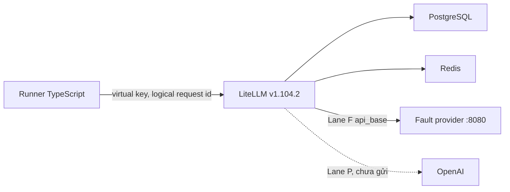
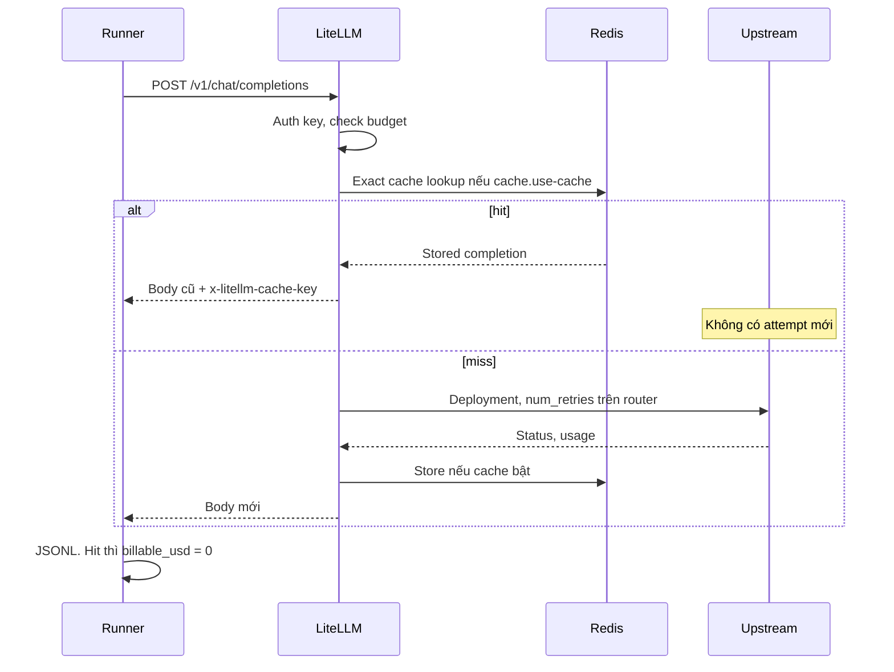

# RouteForge engineering notes

Ngày ghi: 2026-10-10. Tài liệu này gom bài học kỹ thuật của lab vào một chỗ. ADR trong `docs/adr/` giữ nguyên. Nguồn số liệu là code, manifest, và artifact đã có trong repo.

## Cách đọc nhãn bằng chứng

| Nhãn | Nghĩa trong tài liệu này |
| --- | --- |
| MEASURED | Số đọc từ artifact hoặc từ `npm test` trong phiên ghi tài liệu |
| VERIFIED | Hành vi đọc được từ code RouteForge hiện tại |
| UNVERIFIED | Claim nằm trong `docs/research/` hoặc `docs/plan/`, phiên này không fetch lại trang ngoài và không mở lại source tree của LiteLLM |
| ASSUMED | Giả định còn trong plan, chưa có số đo của lab |
| PROPOSED | Việc chưa làm. Không phải kết quả |

Research ngày 2026-10-10 trong `docs/research/` là hồ sơ thiết kế, không phải benchmark đã chạy. `docs/research/benchmark-design.md` nói thẳng là research pass đó không execute benchmark.

## Mục lục

1. [Project motivation](#1-project-motivation)
2. [Architecture](#2-architecture)
3. [AI cost optimization](#3-ai-cost-optimization)
4. [Backend reliability patterns](#4-backend-reliability-patterns)
5. [Lane F incident case study](#5-lane-f-incident-case-study)
6. [Cache correctness and security](#6-cache-correctness-and-security)
7. [Benchmark methodology](#7-benchmark-methodology)
8. [Engineering judgment](#8-engineering-judgment)
9. [Senior Backend interview preparation](#9-senior-backend-interview-preparation)
10. [Future research backlog](#10-future-research-backlog)
11. [Lane P readiness snapshot](#11-lane-p-readiness-snapshot)

---

## 1. Project motivation

### Vì sao một AI gateway đáng để đo

Một ứng dụng gọi model thường muốn một API kiểu OpenAI, rồi phía sau có nhiều provider, nhiều mức giá, và nhiều kiểu lỗi. Gateway là chỗ đặt những việc đó: xác thực, cache, retry, fallback, budget, và sổ spend.

RouteForge không xây gateway mới. Lab đo những trade-off mà gateway tạo ra khi người ta bật cache và reliability policy. Câu hỏi của lab là: một lần gọi client đắt bao nhiêu, chậm bao nhiêu, có gọi nhầm upstream bao nhiêu lần, và câu trả lời có còn là câu trả lời mình định chấm hay không.

### Bốn trục đổi chỗ cho nhau

| Trục | Khi siết một phía | Cái được trả |
| --- | --- | --- |
| Cost | Gateway exact cache trả body cũ, `billable_usd = 0` | Câu trả lời bị đóng băng đến hết TTL. Traffic không lặp byte thì không được giảm giá |
| Latency | Hit gần như chỉ còn Redis. Miss vẫn là một generation | p50 hit và p50 miss không được cộng vào một số |
| Reliability | Retry và fallback tăng cơ hội có HTTP 200 | Mỗi attempt là một generation. Timeout ngắn có thể bỏ dở output mà provider vẫn tính tiền |
| Quality | Đổi sang model rẻ hơn làm median bill giảm | Đó là một hệ thống khác, không phải cùng một task được tối ưu |

Output thường đắt hơn input nhiều lần trên price card của lab (input 0.40 USD / 1M, output 1.60 USD / 1M cho `gpt-4.1-mini-2025-04-14`). Một thay đổi giảm input token nhưng kéo dài câu trả lời có thể làm hóa đơn tăng. Vì vậy sổ phải nhân từng token class với giá của class đó.

### LiteLLM làm gì, RouteForge làm gì

LiteLLM Proxy OSS giữ provider I/O, virtual key, Redis exact cache, retry, cooldown, fallback, và dòng spend trên PostgreSQL. Quyết định này là [ADR 001](../adr/001-gateway-litellm-oss.md).

RouteForge giữ phần mà gateway không biến thành một thí nghiệm:

- Price card có ngày, để `usd` của lab có thể lệch `x-litellm-response-cost`.
- Reservation trên runner, dừng trước khi gửi nếu ước lượng vượt trần.
- Fault provider đếm attempt theo logical request id.
- Báo cáo tách gateway hit khỏi provider `cached_tokens`.
- Lane P bị từ chối trừ khi `ROUTEFORGE_ALLOW_PAID` đúng bằng `1`, và slice hiện tại vẫn từ chối sau đó.

Pattern chuyển được sang backend Node.js: đừng tái hiện một dependency đã có sổ và adapter. Viết control plane nhỏ quanh nó, và giữ ledger của mình ở file mình regenerate được khi process kia mất span.

---

## 2. Architecture

### Thành phần

| Thành phần | Việc nó sở hữu | Việc nó không sở hữu |
| --- | --- | --- |
| Runner TypeScript, `src/runner/` | Manifest, reservation, JSONL, report, chặn Lane P | Provider API key, thứ tự fallback |
| LiteLLM `v1.104.2`, một replica | Auth, exact cache, router, spend log | Điểm chất lượng, phiên bản price card |
| Redis 7.4.7 | Exact-cache entry và router state. DB 0 là Lane F, DB 1 là Lane P | Bản duy nhất của spend |
| PostgreSQL 16.11 | Key, team, spend log. `store_prompts_in_spend_logs: false` | Body prompt |
| Fault provider, `src/fault-provider/` | 200, 429, 500, sleep, event log | Bất kỳ số nào mang nhãn "API cost" |
| Price card `prices/openai-standard-2026-10-10.json` | USD theo token class, theo model id, theo ngày | Scrape giá trong lúc chạy |

Pin image nằm ở `config/image-pins.json` và `docker-compose.yml`. MEASURED trên cả run lỗi và run xanh: LiteLLM `ghcr.io/berriai/litellm:v1.104.2@sha256:3d88bd757134a00e8c00237b85a021ab1f6d54abb9c1df750f411dbe7256a500`, Redis `sha256:02f2cc4882f8bf87c79a220ac958f58c700bdec0dfb9b9ea61b62fb0e8f1bfcf`, Postgres `sha256:4327b9fd295502f326f44153a1045a7170ddbfffed1c3829798328556cfd09e2`, fault base `node:22.22.2-bookworm-slim@sha256:9f6d5975c7dca860947d3915877f85607946403fc55349f39b4bc3688448bb6e`. Node trên host của hai run đó là `v22.22.2`.

OpenTelemetry và k6 có trong research. [ADR 002](../adr/002-typescript-runner-and-data-stores.md) để chúng sau slice đầu. Runner phát traffic Lane F để chỉ còn một retry layer: proxy.

### Vì sao từng công nghệ

- LiteLLM: capability inventory (exact cache, fallback, virtual key, spend) nằm trên image MIT. Portkey, Bifrost, Kong được so trong `docs/research/existing-solutions.md`. Phần "LiteLLM là base tốt nhất" trong research là lựa chọn đã khóa bởi ADR 001, không phải một bake-off lab đã đo. UNVERIFIED đối với số overhead của vendor khác.
- Redis: LiteLLM ghi rằng nhiều worker mà không có Redis thì cache và cooldown không còn là một view chung. Lab chỉ chạy một replica và vẫn bật Redis, để config giống rule production mà lab đang dạy. UNVERIFIED đối với bài sizing gốc; VERIFIED là compose và `config/litellm-lane-f.yaml` đang trỏ Redis.
- PostgreSQL: system of record cho key và spend. Redis có thể mất entry khi flush. Lane F flush DB 0 giữa các scenario bằng `flushRedisDb` trong `src/runner/redis.ts`.
- Node.js 22: runner và fault provider cùng ngôn ngữ, không nằm trong image LiteLLM. Upgrade proxy là đổi digest, không phải merge fork.

### Request lifecycle



Lane P trên hình là nét đứt vì `refuseLaneP` ném lỗi trước mọi socket. VERIFIED trong `src/runner/cli.ts` và `test/cli.test.ts`.



Thứ tự này là lý do cache đứng trước routing. Một hit không được tính là fallback success và không được phát sinh bill provider mới.

### Hai lane, một binary

Compose hiện mount `config/litellm-lane-f.yaml`. `config/litellm-lane-p.yaml` không được start. VERIFIED trong `docker-compose.yml`.

| | Lane F | Lane P |
| --- | --- | --- |
| Upstream | Fault provider | Một deployment OpenAI. Chưa được gọi |
| Redis | DB 0, namespace `routeforge-lane-f` | DB 1, namespace `routeforge-lane-p` |
| `num_retries` router | 2 | 0 |
| Fallback | `lab-chat` → `lab-chat-fallback` | `fallbacks: []` |
| Model groups | `lab-chat`, `lab-chat-fallback`, `lab-chat-retry` | Chỉ `lab-chat` |
| Claim được phép | Attempt, hit, status, latency local | Token và USD thật, khi nào có run |
| `billable_usd` | 0 | Chưa có row |

`lab-chat-retry` tồn tại vì hai deployment chung một `model_name` bị `simple-shuffle`, không phải ordered fallback. `fault-429` gọi group không có fallback để client giữ status 429. Chi tiết ở `docs/plan/litellm-v1.104.2-validation.md`.

---

## 3. AI cost optimization

### Hai cache khác nhau

Gateway exact cache và provider prompt cache chồng lên nhau và hỏng theo cách khác nhau.

| | Gateway exact cache | Provider prompt cache |
| --- | --- | --- |
| Khi nào khớp | Hash cả request. Đổi một byte là miss | Prefix đủ dài, cùng deployment, còn trong TTL của provider |
| Có gọi model không | Hit thì không | Vẫn gọi. Chỉ giảm giá phần prefix |
| Latency | Rất thấp so với generation | Vẫn là một generation, rẻ hơn chứ không biến mất |
| Chất lượng | Lặp lại đúng sample đã lưu | Model vẫn sinh câu mới ở suffix |
| Bill | Incremental provider spend = 0 | `cached_tokens` nhân giá cached input, phần còn lại nhân giá input |

Trên pin `v1.104.2`, cache mode là `default_off`. Request chỉ vào cache khi body có `cache.use-cache: true`. Virtual key không nằm trong exact cache key. UNVERIFIED trong phiên này đối với từng dòng `get_cache_key` của LiteLLM; hồ sơ đọc source nằm ở validation doc. MEASURED trên Lane F: call `shared-key` dùng key `f-nocache` với cùng body cache-on và nhận hit, 0 upstream. Run xanh `lane-f-20261009T201203Z`, item `shared-key`, `gateway_cache: hit`, `upstream_attempts: 0`, latency 19 ms.

Semantic cache tắt. Research ghi hazard replay tool-call trên traffic gần giống nhau. Lab chưa đo hazard đó. UNVERIFIED như một thí nghiệm của RouteForge. VERIFIED là config không có `similarity_threshold` hay `redis-semantic`, và `classifyGatewayCache` ném lỗi nếu thấy `x-litellm-semantic-similarity`.

### Bốn lớp token

Đừng cộng mọi thứ thành một cột "cached tokens".

| Lớp | Ý nghĩa trên model đang pin |
| --- | --- |
| Logical input | Token người gọi định gửi. Ước lượng tokenizer chỉ để lập kế hoạch |
| Upstream prompt | `usage.prompt_tokens` trên response provider |
| Cached | `usage.prompt_tokens_details.cached_tokens`. Vẫn nằm trong `prompt_tokens` |
| Billed | Tiền. Hit gateway thì lớp này là 0 dù body cũ vẫn mang `usage` |

Công thức trong `priceUsageUsd` (`src/runner/price.ts`), VERIFIED bằng test:

```text
uncached = prompt_tokens - cached_tokens
billable = uncached * 0.40 / 1e6
         + cached   * 0.10 / 1e6
         + completion * 1.60 / 1e6
```

`cache_write_per_million` trên card là `null` cho cả `gpt-4.1-mini-2025-04-14` và `gpt-5-nano`. Hàm giá không cộng write premium. Nếu ai đó nhân cả `prompt_tokens` với giá input rồi cộng thêm `cached_tokens` với giá cached, prefix bị tính hai lần.

Ví dụ khóa bởi test, không phải một call OpenAI. `prompt_tokens = 2176`, `cached_tokens = 2048`, `completion_tokens = 64`:

- Đúng: `(128 * 0.40 + 2048 * 0.10 + 64 * 1.60) / 1e6 = 0.0003584` USD
- Sai, đếm kép: `(2176 * 0.40 + 2048 * 0.10 + 64 * 1.60) / 1e6 = 0.0011776` USD

`incrementalProviderUsd("hit", priced)` trả 0. `settle` thay estimate bằng 0. Usage replay chỉ được giữ ở `counterfactual_usd`.

Usage cố định của fault provider là 12 prompt + 4 completion. `priceUsageUsd` cho ra `0.0000112` USD. JSONL ghi `synthetic_usd` xấp xỉ số đó và `billable_usd: 0`. MEASURED trên các row 200 của Lane F. `synthetic_usd` không được cộng vào tổng trả phí.

Giá trên card trỏ `https://developers.openai.com/api/docs/pricing`, `fetched_on: 2026-10-10`. Phiên này không mở lại trang đó. Tỷ giá là VERIFIED như nội dung file, UNVERIFIED như một lần đối chiếu invoice.

### Routing và chọn model

[ADR 004](../adr/004-three-benchmark-arms.md) tách ba cánh tay thay vì một cánh "optimized" trộn prefix, gateway cache, và output cap.

| Arm | Cache gateway | Prompt | Câu nó trả lời |
| --- | --- | --- | --- |
| `A-baseline` | off | Nonce mới ở đầu mỗi call | Giá input đầy, prefix không thể khớp |
| `B-provider-cache` | off | Prefix ổn định, suffix đổi | `cached_tokens` sau warmup |
| `C-gateway-exact` | on | Cùng byte với repeat của B | Hit, bill 0, body giống lần đầu |

`gpt-5-nano` có trên card (input 0.05, cached 0.005, output 0.40 USD / 1M) với `status: inactive`. `assertModelActive` ném `InactiveModelError`. VERIFIED. Nhét model rẻ vào baseline là một thí nghiệm khác.

`cost-based-routing` và Auto Router không bật. Research trích savings 37–69% của LiteLLM và các tỷ lệ RouteLLM 2024. Những số đó là UNVERIFIED đối với workload này và không phải acceptance test. Xem `docs/research/existing-solutions.md`.

---

## 4. Backend reliability patterns

Các pattern dưới đây là bài của Lane F và của bất kỳ service Node nào đứng trước một dependency tính tiền theo attempt.

### Retry và retry amplification

Amplification là `upstream_attempts / client_requests`. Một policy `num_retries: 2` nghĩa là 1 lần gọi cộng 2 lần thử lại, tức 3 upstream call trên deployment đó nếu mọi lần đều fail.

Runner không retry. k6 chưa có trong slice. Nếu client cũng retry, tỷ lệ không còn là policy của proxy.

MEASURED, run xanh `lane-f-20261009T201203Z`:

| Scenario | Client | Primary | Fallback | Amplification | Kỳ vọng |
| --- | --- | --- | --- | --- | --- |
| `fault-429` | 20 × HTTP 429 | 60 | 0 | 3.0 | 3 primary, không fallback |
| `fault-500` | 20 × HTTP 200 | 60 | 20 | 4.0 | 3 primary rồi 1 fallback |
| `fault-timeout` | 10 × HTTP 200 | 30 | 10 | 4.0 | Cùng hình với 500 |

Mỗi row 429 có `upstream_attempts: 3`. Mỗi row 500 và timeout có `4`. Không có số âm.

### Nested retry giữa các lớp

Router retry và SDK retry là hai vòng lặp. Trên pin này, hồ sơ validation đọc `litellm/llms/openai/openai.py`: handler `pop("max_retries", 2)`. `setdefault("max_retries", 0)` của router không đè một giá trị đã có, và deployment không khai báo `max_retries` thì client OpenAI dùng default 2 bên trong mỗi router attempt. Vòng `for _ in range(2)` cùng file chỉ sửa 422 lệch role; 429 và 500 bị re-raise. UNVERIFIED trong phiên này vì không mở lại tree LiteLLM. Hồ sơ đó là `docs/plan/litellm-v1.104.2-validation.md`.

Hệ quả thiết kế: mỗi deployment Lane F đặt `max_retries: 0`. `assertLaneFReady` từ chối config nếu không đủ ba dòng đó. `litellm_settings.num_retries` bị gỡ khỏi Lane F để chỉ còn router `num_retries: 2`.

Lane P cũng phải có `max_retries: 0` trên deployment. Thiếu dòng này thì `num_retries: 0` ở router không chứng minh SDK sẽ im. Phiên readiness đã thêm dòng đó vào `config/litellm-lane-p.yaml` và khóa bằng `assertPaidLane`. Xem mục 11.

Có một sự thật đo được cần giữ cạnh lời giải thích trên. Run `lane-f-20261009T191637Z` vẫn dùng proxy hash cũ `633d1dc4…` (snapshot không có deployment `max_retries: 0`, vẫn còn `litellm_settings.num_retries: 2`) nhưng đếm theo request id và đã ra đúng 3.0 / 4.0 / 4.0. Pin `max_retries: 0` là chốt cho default đã đọc trong source. Nó không phải điều kiện duy nhất đã làm scenario gate chuyển từ đỏ sang xanh. Phần làm gate xanh trước đó là cách đếm. Chi tiết ở mục 5.

### Timeout và deadline

`fault-timeout`: primary ngủ `latency + ROUTEFORGE_TIMEOUT_MS`. Compose đặt `ROUTEFORGE_TIMEOUT_MS=5000`. Deployment primary có `timeout: 2`. Fallback có `timeout: 30`. Client của runner dùng `AbortSignal.timeout(180_000)` để không tự cắt trước proxy.

Worst case mà research viết: `request_timeout * (1 + num_retries) * fallback_depth`. Lane F đo được p50 khoảng 10.9 s cho timeout scenario (10 941 ms trên run xanh, 10 980 ms trên run trung gian). Đó là đồng hồ client, gồm 3 lần primary quá hạn rồi một fallback 200. Không suy ra SLO của OpenAI từ số này.

Trên provider thật, client timeout không chứng minh generation đã dừng. Vì vậy timeout drill ở lại Lane F. Lane P đặt timeout 30 s và retry 0. ASSUMED rằng 30 s là đủ cho một completion ngắn; chưa có call trả phí để đo.

Deadline nên là một ngân sách truyền xuống, không phải mỗi lớp một timeout độc lập cộng dồn trong im lặng. Lab chưa có deadline propagation xuyên LiteLLM. Cái đang có là timeout từng deployment, ghi trong config.

### Fallback và giới hạn của nó

Fallback là một generation mới. `fault-500` và `fault-timeout` thành công về availability (client 200) và vẫn tốn 4 upstream call. `fallback_used` true khi có attempt role `fallback`.

Fallback cùng provider không cứu outage của provider đó. Fallback sang model rẻ đổi chất lượng đúng lúc hệ thống đang bệnh. [ADR 005](../adr/005-fallback-and-local-fault-lane.md) cấm `budget_fallbacks` sang `gpt-5-nano`. Lane P không có fallback.

LiteLLM từ v1.85.0 không còn honor `mock_testing_fallbacks` trên request vào proxy. UNVERIFIED lại docs; lab làm lỗi HTTP thật từ fault provider. VERIFIED: `decide()` trả 429 kèm `Retry-After: 1`, 500, hoặc delay.

Cooldown: router `allowed_fails: 2`, `cooldown_time: 30`. Deployment đo được đặt `model_info.allowed_fails: 1000` vì ngưỡng 2 sẽ làm 20 call liên tiếp bị skip khỏi rotation, và khi đó không còn đo vòng retry. Report in cả hai số. Một group một deployment còn return sớm khỏi cooldown trong `_should_cooldown_based_on_deployment_policy` theo validation doc. UNVERIFIED lại file Python đó.

### Circuit breaker

Cooldown của LiteLLM là circuit breaker theo deployment: quá `allowed_fails` trong cửa sổ thì nghỉ `cooldown_time`. Lab cố tình nâng `allowed_fails` của deployment để cửa sổ 20 call không mở breaker. Đó là lựa chọn đo lường, không phải khuyến nghị production.

Production thường muốn breaker mở. Lab muốn thấy đủ 3 attempt. Hai mục tiêu đó xung đột trên cùng một counter. Cách giải là ghi cả policy router (2) và ngưỡng đang hiệu lực (1000), không giả vờ chúng là một số.

### Rate limit, backpressure, cache stampede

429 là backpressure. Retry ngay lập tức nhân tải lên chính chỗ đang từ chối. Fault provider gửi `Retry-After: 1`. Timeline một request sau khi sửa config, ghi trong validation doc, không đo lại trong phiên này: arrival +0 ms, +1133 ms, +2846 ms, client trả về ở 7108 ms. UNVERIFIED như một lần chạy lại; số nằm trong validation doc.

Stampede: nhiều miss giống hệt cùng lúc đều gọi upstream, rồi mới ghi cache. Research nói coordinator PR 20030 của LiteLLM là single-flight cho global spend read, không phải completion cache. UNVERIFIED lại PR. Lab đo completion stampede trực tiếp.

MEASURED, `fault-stampede`, 20 request concurrent, body có `run_id`, cache-on, sau flush Redis DB 0:

| Run | Upstream được gán | Ghi chú |
| --- | --- | --- |
| `lane-f-20261009T190546Z` | 11 | Report pass vì không yêu cầu bằng 1. Đếm lúc đó còn là global delta |
| `lane-f-20261009T190606Z` | 0 trên mọi row, `gateway_cache: miss` | Không gán được arrival. Fail |
| `lane-f-20261009T191637Z` | 0 | Vẫn miss attribution |
| `lane-f-20261009T201203Z` | 13 primary, 7 row có 0 attempt và `gateway_cache: hit` | Pass. p50 579 ms |

Validation doc còn ghi một repro 20 call: 12 arrival được gán, 0 unattributed. Khác run chấp nhận (13). Cả hai đều nói: không có single-flight. PROPOSED: coalescer phía client nếu sau này số gần N thành vấn đề. Không fork LiteLLM chỉ để khóa.

### Budget enforcement và bill thật

Bốn lớp, không lớp nào một mình là hard cap của OpenAI:

1. Reservation runner: estimate bằng giá input chưa cache cộng full output cap. `committed + estimate > 1.50` hoặc `sent + 1 > 80` thì không gửi. VERIFIED, `src/runner/reservation.ts`.
2. `max_tokens: 64`. Manifest lệch thì `assertLaneFReady` / `assertLanePManifest` dừng.
3. Virtual key `max_budget`. `f-budget` được `scripts/bootstrap-keys.ts` đặt `spend: 1`, `max_budget: 0.01`.
4. Limit dự án phía OpenAI. Plan gọi đây là operator control. Lab chưa đo tốc độ lan truyền. UNVERIFIED.

MEASURED `fault-budget` trên run xanh: HTTP 422, 0 upstream, latency 131 ms, body bị `errorClass` xếp vào `budget`. Run lỗi cũng pass scenario này: HTTP 422, 0 upstream, 218 ms.

Sau response, `settle` thay estimate bằng `billable`. Hit thì số đó là 0. Lỗi vận chuyển không có usage thì để nguyên estimate, vì provider có thể đã generate. VERIFIED.

`reserve()` không biết trần 5.00 USD xuyên nhiều invocation. Hai `ReservationState` độc lập đều được phép commit 1.50. VERIFIED bằng test. Cộng dồn artifact là hạng mục P1.7 trong `docs/plan/tasks.md`, chưa làm. PROPOSED.

Postgres spend insert có thể batch. Runner không poll Postgres để quyết định call tiếp. Reservation local mới là điểm dừng.

---

## 5. Lane F incident case study

### Hành vi mong đợi

`manifests/phase1-lane-f.yaml` và README:

| Scenario | Pass khi |
| --- | --- |
| `exact-cache-repeat` | Call cache-on đầu: 1 primary. Call thứ hai: hit, `x-litellm-cache-key`, 0 attempt, body khớp. `f-nocache` không flag: upstream cả hai lần. Key thứ hai với cùng body cache-on: vẫn hit |
| `fault-429` | 20 client đều 429, mỗi client 3 primary, amplification 3.0, không fallback |
| `fault-500` | 20 client 200, 60 primary, 20 fallback |
| `fault-timeout` | 10 client 200, 30 primary, 10 fallback |
| `fault-stampede` | 20 concurrent, ghi upstream count, không bắt buộc bằng 1, nhưng phải gán được ít nhất một arrival |
| `fault-budget` | Lỗi budget, 0 attempt |

76 client send. `billable_usd` = 0. Seed `20261010`. Model id `gpt-4.1-mini-2025-04-14`.

### Run lỗi `artifacts/lane-f-20261009T190606Z`

MEASURED từ `report.md` và `requests.jsonl`.

- Bắt đầu `2026-10-09T19:06:06.164Z`, xong `2026-10-09T19:10:48.883Z`
- Git commit ghi `not-a-git-repo`
- Proxy config hash `633d1dc4a8de45cc0d52a6a7bf8f2158f80045a337a0c0cf11f5d453ba240c8a`
- Manifest hash `bc31107c91fbddd26464dc06cdf4bde36430b487b87de38fdfc818afd4db7e9e`
- Price card hash `d8e481ea993709bcc8be0ca590ac0f5d3152f9232859aa41738ca4c1e7d55b99`
- 76 send, `billable_usd` 0, `committed_usd` 0
- 1/6 pass. Chỉ `fault-budget`

| Scenario | Pass | Clients | Upstream trong report | Primary | Fallback | Amp | p50 ms |
| --- | --- | --- | --- | --- | --- | --- | --- |
| exact-cache-repeat | fail | 5 | 2 | 2 | 0 | 0.4 | 120 |
| fault-429 | fail | 20 | 19 | 17 | 2 | 0.95 | 4258 |
| fault-500 | fail | 20 | 26 | 19 | 7 | 1.3 | 4968 |
| fault-timeout | fail | 10 | 4 | 3 | 1 | 0.4 | 10506 |
| fault-stampede | fail | 20 | 0 | 0 | 0 | 0.0 | 536 |
| fault-budget | pass | 1 | 0 | 0 | 0 | 0.0 | 218 |

`fault-429` kết thúc bằng 17 status 429 rồi 3 status 500. Đó không phải steady state "mọi call đều 429".

Histogram `upstream_attempts` trong JSONL, MEASURED:

| Scenario | Histogram |
| --- | --- |
| exact-cache-repeat | 0 × 3, 1 × 2 |
| fault-429 | 5 × 3, 6 × 12, 7 × 4, −96 × 1 |
| fault-500 | 7 × 1, 8 × 15, 9 × 2, 10 × 1, −129 × 1 |
| fault-timeout | 1 × 3, 6 × 2, 8 × 2, 10 × 2, −47 × 1 |
| fault-stampede | 0 × 20, mọi row `gateway_cache: miss` |
| fault-budget | 0 × 1, status 422 |

Tổng histogram khớp cột Upstream của report, vì report cộng delta đã hỏng:

- 429: `3*5 + 12*6 + 4*7 - 96 = 19`
- 500: `1*7 + 15*8 + 2*9 + 1*10 - 129 = 26`
- timeout: `3*1 + 2*6 + 2*8 + 2*10 - 47 = 4`

Row âm, MEASURED: `fault-429-18` = −96 status 500; `fault-500-17` = −129 status 200; `fault-timeout-7` = −47 status 200. Validation doc tách −129 thành −97 primary và −32 fallback. Phần tách đó không có trong JSONL (JSONL chỉ có tổng). UNVERIFIED lại như một counter nội bộ; chỉ có trong validation doc.

`exact-1` đã là hit trước khi scenario "chứng minh miss": `upstream_attempts: 0`, `gateway_cache: hit`, latency 99 ms, `prompt_tokens: 12` replay từ body cố định. `exact-2` cũng hit, 102 ms.

### Vì sao thấy khoảng 6 attempt thay vì 3

Hai cơ chế chồng nhau. Đừng gộp chúng thành một câu.

Cơ chế đo, MEASURED. Runner lúc đó lấy tổng counter của cả process quanh mỗi client call rồi trừ. Reset counter khi một call còn mở làm `arrivals_since_wipe - previous_total` thành số âm. Không có clamp về 0. Mode của histogram 429 là 6 (12/20 row) trước row −96. Mode của 500 là 8, tức hình "6 primary + 2 fallback" mà validation doc mô tả cho steady row trước lần wipe.

Cơ chế gateway, UNVERIFIED lại source trong phiên này, ghi trong validation doc: router `num_retries: 2` là 3 attempt logic; OpenAI client default `max_retries` 2 nằm trong mỗi attempt; 3 × 2 = 6 HTTP request trên primary. Snapshot proxy của run này không có `max_retries` trên deployment và có `litellm_settings.num_retries: 2`. VERIFIED bằng cách đọc `artifacts/lane-f-20261009T190606Z/snapshot/proxy.yaml`.

Run kề `lane-f-20261009T190546Z` cùng hash config, histogram 429 là 3 × 3, 5 × 1, 6 × 14, 7 × 1, −4 × 1. Cùng họ lỗi.

Run `lane-f-20261009T191637Z` cùng hash config cũ, note trong report đã nói counter theo request id. MEASURED: 429 đúng 3 × 20, 500 đúng 4 × 20, timeout đúng 4 × 10. Exact-cache và stampede vẫn fail. Như vậy trên cửa sổ full scenario, đổi cách đếm đã ra đúng 3 và 4 trong khi yaml chưa pin `max_retries: 0`. Lời giải thích "6 HTTP request vì nested SDK retry" mô tả mode của counter global trên run 190606Z và mô tả default trong source. Nó không được xác nhận lại bằng event log trên chính hash config đó, vì event log chỉ có sau khi config đã đổi, trên run xanh.

Một request repro sau khi đã `max_retries: 0`, validation doc: 429 thì 3 primary, timeline +0 / +1133 / +2846 ms; 500 thì 3 primary + 1 fallback ở +4735 ms. Không chạy lại trong phiên này.

`artifacts/pg-tail.txt` MEASURED: Postgres nhận fast shutdown và `terminating connection due to administrator command` lúc `2026-10-09 18:52:52.602 UTC`, rồi `database system is shut down` lúc 18:52:54. File tail không in mã `57P01` và không có dòng nào trong cửa sổ 19:06–19:10 của run lỗi. Validation doc gắn `57P01` với lần restart làm counter âm. Liên kết nhân quả đó là hồ sơ dự án, không được chứng minh lại chỉ bằng tail file này. Tail chứng minh có một lần administrator shutdown sớm hơn run khoảng 13 phút.

### Vì sao event log append-only sửa attribution

Counter toàn process là một số. Trừ hai lần đọc thì mất danh tính: attempt của request nào, role nào, đến trước hay sau khi client đã xong, thuộc boot nào.

`FaultState` trong `src/fault-provider/state.ts` giờ append `AttemptEvent`: `attempt_id`, `boot_id`, `scenario_id`, `logical_request_id`, `role`, `arrived_at`, `completed_at`, `client_finished_at`, `status`. `accountAttempts` chỉ đếm event có cùng logical id. Arrival sau `client_finished_at` vẫn được đếm và được đánh `late`. `POST /_reset` trả 409 khi `in_flight !== 0`. Đổi `boot_id` giữa chừng thì `lane-f.ts` fail run. VERIFIED trong `test/events.test.ts` và `src/runner/lane-f.ts`.

Header `x-routeforge-request-id` đi cùng request. `forward_client_headers_to_llm_api: true` để proxy chuyển header đó tới fault provider. Không có id thì event rơi vào `unattributed` và không được cộng vào row.

Số âm biến mất vì không còn phép trừ. Thiếu attribution biến thành 0 có chủ đích trên một id, và scenario stampede fail nếu tổng đó dưới 1, thay vì giả vờ single-flight.

### Trước và sau

| | `190606Z` đo global | `191637Z` đếm theo id, yaml cũ | `201203Z` event log + yaml mới |
| --- | --- | --- | --- |
| Proxy hash | `633d1dc4…` | `633d1dc4…` | `956fa886…` |
| 429 | mode 6, một row −96, 3 client 500 | 20 × đúng 3, toàn 429 | 20 × đúng 3, toàn 429 |
| 500 | mode 8, một row −129 | 20 × đúng 4 | 20 × đúng 4 |
| timeout | histogram rời, một row −47 | 10 × đúng 4 | 10 × đúng 4 |
| exact cache | call đầu đã hit, 99 ms | vẫn fail cách ly | miss 1461 ms rồi hit 26 ms |
| stampede | 0 attempt gán được | 0 | 13 attempt |
| budget | pass, 422 | pass, 422 | pass, 422 |
| Kết quả | 1/6 | 4/6 | 6/6 |

### Đúng những thay đổi đã giải quyết

Config, so snapshot `190606Z` với `config/litellm-lane-f.yaml` hiện tại:

- Thêm `max_retries: 0` trên cả ba deployment.
- Xóa `litellm_settings.num_retries: 2`. Router `num_retries: 2` là retry duy nhất.
- Giữ `model_info.allowed_fails: 1000` và router `allowed_fails: 2`.
- Hash manifest Lane F khóa ở `956fa88622fcea6e4b820ff82615426e51d9f82ea0735ec1c464939a4f634acd`.

Code:

- `src/fault-provider/events.ts`, `state.ts`: event append-only, reset 409, cờ late.
- `src/runner/lane-f.ts`: `accountAttempts` theo id, `drainFaultProvider` trước scenario, flush Redis DB 0, body exact-cache và stampede chứa `runId`.
- `src/runner/classify.ts`: hit chỉ khi có cache-key header và 0 attempt mới. Usage replay không đủ.
- `POST /_client-finished` ghi thời điểm client xong để phát hiện attempt đến muộn.

Cache isolation: flush Redis không xóa cache trong process của proxy. Prompt hằng số bị hit từ run trước. Body mới chứa run id. Hai call trong cùng một run vẫn cùng byte với nhau. Repro `repro-20261009T200943Z` trong validation doc: call cache-on đầu 1 primary và không có cache-key header; call thứ hai 0 upstream, key `routeforge-lane-f:98e015e360c0a8adc7cbad65428f77c6b3a598c37d6591904df20eb5d3dd6ac5`; `f-nocache` không flag thì 1 primary; `f-nocache` có flag thì hit cùng key. Không chạy lại repro trong phiên này.

### Bằng chứng xanh

`artifacts/lane-f-20261009T201203Z`, MEASURED.

- `2026-10-09T20:12:03.078Z` → `2026-10-09T20:17:07.301Z`
- 6/6 pass, 76 send, `billable_usd` 0
- `fault_boot_id=1f4a3669-2bfb-4797-ab63-061ac03af55a` không đổi giữa run
- Spend log HTTP 200, marker `ROUTEFORGE_PROMPT_MARKER_do_not_log` vắng mặt
- Exact: `exact-1` miss, 1 primary, 1461 ms; `exact-2` hit, 0 attempt, 26 ms; hai call `f-nocache` không flag mỗi call 1 attempt; `shared-key` hit
- Stampede: 13 upstream, 7 hit. Note của report: không giả định single-flight
- p50: exact 26 ms (cả 5 call, gồm hit rất nhanh), 429 là 4187 ms, 500 là 4794 ms, timeout là 10941 ms, stampede 579 ms, budget 131 ms

`npm test` trong phiên ghi tài liệu này: 34 pass, 0 fail. Ngữ cảnh nhiệm vụ nói suite Lane F xanh có 22 unit test. Cây test trước khi thêm guardrail Lane P trong phiên này có 25 khai báo `test()`. Không có artifact nào trong repo ghi số 22. Chênh 25 so với 22 không được giải thích thêm ở đây.

Phiên này không chạy lại Lane F và không đụng Docker.

---

## 6. Cache correctness and security

### Cache trong process và flush Redis

Exact cache của proxy có Redis và còn một cache trong process. `flushRedisDb` chỉ gửi `SELECT` rồi `FLUSHDB`. MEASURED là call đầu của run lỗi đã hit dù report ghi Redis flushed between scenarios. Sửa: đưa `runId` vào prompt để key đổi giữa các run. Trong một run, hai call exact vẫn cùng byte, nên hit thứ hai vẫn là hit thật.

Bài chuyển được: invalidate một tier không invalidate tier kia. Test cô lập phải đổi key hoặc restart process, không chỉ xóa database.

### Cách ly theo run

Stampede và exact-cache dùng prompt có `runId`. Các scenario fault dùng content khác nhau theo index (`fault-429 call 1`, …) và `useCache: false`, nên không dựa vào cache để "pass" vòng retry.

`prepare()` drain call đang mở, flush DB 0, reset event log, rồi `POST /_control` đặt scenario. Reset bị 409 thì run dừng, thay vì xóa đếm khi request còn sống.

### Virtual key dùng lại và partition

Bootstrap tạo `f-nocache`, `f-exact`, `f-budget`, `p-nocache`, `p-exact`. VERIFIED trong `scripts/bootstrap-keys.ts`. Key không thêm `cache.use-cache`. Lane F bật cache trên body.

Hệ quả đã đo: `f-exact` và `f-nocache` dùng chung một Redis entry nếu cả hai gửi cùng body với flag. ADR 004 viết khác biệt request-path giữa arm B và C là virtual key. Trên pin này điều đó không đúng với exact cache. Khi làm Lane P, arm C phải đặt `cache.use-cache: true` trên body, arm A và B phải bỏ flag. Key alias một mình không cách ly. PROPOSED cho code Lane P, vì execution chưa có. MEASURED cho hành vi key trên Lane F.

### Multi-tenant

Exact cache không hash virtual key, nên hai tenant cùng body và cùng flag thấy cùng completion. Đó là rò dữ liệu nếu prompt hoặc câu trả lời là riêng. Semantic cache còn rộng hơn theo research (scope key/team/org). Lab tắt semantic cache và chưa có test hai `user` id với cùng body cache-on phải khác entry. `user` đang được gửi (`exact-cache-user` so với `nocache-user-*`) nhưng miss của nocache là vì không có flag, không phải vì `user` tách cache.

Prompt không vào spend log: marker vắng trong `/spend/logs` trên run xanh. VERIFIED bằng assertion của runner, MEASURED bằng note của report. Kết quả local vẫn chứa prompt nếu quality scoring cần. Artifact là dữ liệu lab. Đừng ship mặc định sang một trace vendor.

### Không bill usage replay lần thứ hai

Hit copy completion đã lưu, kể cả `usage`. Header xác nhận hit trên pin này là `x-litellm-cache-key`, không có `x-litellm-cache-hit`. UNVERIFIED lại `get_custom_headers`; validation doc ghi vậy, và runner chỉ tin header đó cộng với 0 event upstream.

`incrementalProviderUsd` trả 0 khi classification là `hit`. Giá của usage replay chỉ là counterfactual. Lane F còn cứng `billable_usd: 0` trên mọi row vì lane này không có provider trả phí. Hai lớp đó không được thay thế cho nhau: Lane F bằng 0 vì không có invoice; Lane P hit bằng 0 vì không có call mới, dù usage trong body khác 0.

---

## 7. Benchmark methodology

### Lane F và Lane P

Lane F trả lời câu về policy của proxy trên một upstream kịch bản. Nó không trả lời câu về USD OpenAI hay latency production.

Lane P, khi được phép chạy, là chỗ duy nhất có cost thật. Concurrency 1. Không stress test. Không drill 429 lên endpoint trả phí. Trần một invocation 1.50 USD. Target cả phase 5.00 USD, gồm một rerun và preflight. [ADR 003](../adr/003-model-budget-and-cost-guardrails.md).

Free tier Gemini và capacity Groq không phải Lane P. Research ghi quota không phải hợp đồng capacity. UNVERIFIED lại trang provider trong phiên này. Lab không backfill Lane P bằng giá 0.

### Ba arm

Đã khóa trong `manifests/phase1-lane-p.yaml`. Runner `loadManifest` chưa parse khối `arms`. VERIFIED: type `Manifest` không có field arm. Text file vẫn chứa `A-baseline`, `B-provider-cache`, `C-gateway-exact`.

Biến bị giữ và biến bị đổi, theo `docs/plan/phase-1.md`:

| Biến | Giữ | Đổi ở |
| --- | --- | --- |
| Model, temperature 0, seed `20261010`, `max_tokens` 64 | Mọi arm | Không đâu trong phase 1 |
| Gateway cache | A và B off | C on, bằng flag trên body, không chỉ bằng tên key |
| Prefix | B và C cùng prefix | A đặt nonce ở token đầu |
| Warmup và steady | Cùng body trong B | Cột `phase` |
| Broken prefix | Ngoài tử số tiết kiệm | Hai call B đặt question trước document |

`prompt_cache_key: routeforge-phase1` là hint, không phải đảm bảo hit. UNVERIFIED lại guide OpenAI trong phiên này; ADR 003 và phase-1 ghi vậy.

Research draft có bốn arm P0–P3 và khoảng 150 call mỗi arm. Phase 1 thắng khi lệch mẫu. Failover không phải arm trả phí.

### Biến kiểm soát, confounder, fixture, warmup

Chưa có `fixtures/qa-v1.json`. VERIFIED bằng test sự vắng mặt. Không có prefix 2048 token, không có answer key, không có hash fixture. Mọi câu về hit rate provider cache là PROPOSED.

Confounder đã biết trên giấy, chưa đo:

- Floor cache của `gpt-4.1-mini` đổi theo request settings. Plan nhắm 2048 token nhìn thấy, một lần nới lên 4096, rồi dừng. ASSUMED rằng 2048 có cơ hội; eligibility là preflight.
- `cached_tokens` làm tròn bội của 128 và bỏ hidden system token. ASSUMED theo guide được trích. Code giá không kiểm tra modulo 128.
- Retention 24 giờ trong guide được phase-1 ghi là có tên `gpt-4.1` và không có tên `gpt-4.1-mini`. ASSUMED `in_memory`, 5–10 phút idle. Gap steady quá 4 phút thì plan đánh `retention_risk` và loại khỏi gate. Chưa có cột đó trong runner Lane P.
- Temperature 0 và seed không phải hợp đồng bitwise qua ngày. Identity của arm C chỉ so trong cùng một run.
- Tokenizer `o200k_base` chưa có trong dependencies. Estimate không được vá bằng padding trong vòng lặp trả phí.

Warmup là row, không phải bước giấu. B miss nếu chưa có call prefix trước đó trong TTL.

### Quality

Không có judge model. Phase 1 muốn exact hoặc normalized match với span trong document giả. Normalize: trim, casefold, gộp whitespace, bỏ một dấu chấm cuối. Gate viết trong plan: fact ít nhất 11/12 mỗi arm, cache identity 12/12 trên repeat của C. Chưa có scorer. PROPOSED.

Paraphrase phải là gateway miss và vẫn được chấm fact, ngoài mẫu số 11/12 nếu câu khó hơn. Report slice riêng.

### Guardrail tiền và rủi ro API trả phí

Worst case một live call trong plan, prefix 4096 + suffix 64 + output 64, không discount:

```text
(4096 + 64) * 0.40 / 1e6 + 64 * 1.60 / 1e6 = 0.0017664 USD
```

VERIFIED là công thức `estimateReservationUsd` cho 4160 input và 64 output. Không VERIFIED như một invoice.

Lưới planned spend trong phase-1 (58 live call một invocation, khoảng 0.10 USD ở prefix 4096, một rerun nữa 0.10, cộng khoảng 0.20) là số kế hoạch. Không có artifact Lane P. Đừng trích 0.20 như tiền đã tiêu.

Rủi ro còn mở, lấy từ phase-1, đều chưa đo trên OpenAI:

- Account limit 5 USD không được lab kiểm tra tốc độ cắt request đang bay.
- Timeout phía client có thể vẫn bị bill.
- Snapshot model có thể 404. Không fallback sang model khác.
- Cost map của LiteLLM có thể lệch price card. Gate `usd_delta` chưa có row để fail.
- Reservation không cộng trần 5 USD qua nhiều lần chạy.

### Cái đã đo và cái còn là giả định

| Câu | Trạng thái |
| --- | --- |
| Retry amplification trên mock là 3.0 khi không fallback, 4.0 khi có một fallback | MEASURED, run `201203Z` |
| Stampede không phải 1 | MEASURED, 13/20 trên run chấp nhận |
| Budget key chặn trước upstream | MEASURED, 422 và 0 attempt |
| Gateway hit không tạo attempt mới và không cộng `billable_usd` | MEASURED trên Lane F; công thức 0 cho Lane P là VERIFIED trong hàm, chưa có row trả phí |
| `cached_tokens > 0` trên `gpt-4.1-mini` | ASSUMED cho đến preflight. Không có số |
| Fact rate 11/12 | PROPOSED. Không có fixture |
| `usd_delta` dưới 1% hoặc 0.0001 USD | PROPOSED. Không có `usd_proxy` từ OpenAI |
| Tiết kiệm theo phần trăm | Không công bố. Chưa có cột |

---

## 8. Engineering judgment

Mỗi quyết định: vấn đề, phương án đã bỏ, vì sao, cái giá, khi nào chọn khác.

### Dùng LiteLLM thay vì tự viết gateway Node

Vấn đề: cần một OpenAI-compatible proxy có cache, retry, key, spend. Tự viết là xây lại adapter.

Đã bỏ: Portkey OSS (ledger và retention nằm trên plan), Bifrost (spend model khác, semantic cache không thuộc phase 1), Kong (policy đúng bài là Enterprise), custom Node proxy.

Vì sao: ADR 001. Lab đo policy xung quanh gateway, không đo một fork.

Cái giá: request path có Python. Bug nested retry nằm trong handler mình không sở hữu. Sửa bằng config `max_retries: 0`, không sửa upstream.

Chọn khác khi: một đo đạc chỉ ra single-flight hoặc router mà config không diễn được, và cái giá fork được ghi trong ADR mới.

### TypeScript ở runner, không ở trong container LiteLLM

Vấn đề: thí nghiệm, trần tiền, và report phải sống sót qua upgrade image.

Đã bỏ: nhét lab code vào image; dùng k6 làm client duy nhất; dùng OTel làm sổ tiền.

Vì sao: JSONL cộng price card regenerate report không cần model. Một span rơi thì mất một đô nếu trace là ledger.

Cái giá: hai ngôn ngữ. Header và usage phải được đọc lại ở biên, không tin một object nội bộ của Python.

Chọn khác khi: team bắt buộc một process TypeScript và chấp nhận tự làm ledger. Đó là lựa chọn B trong roadmap, không phải trạng thái hiện tại.

### Redis kể cả khi một replica

Vấn đề: cache và cooldown per-process làm test không tái hiện được, và làm multi-worker sai trước khi lab có replica thứ hai.

Đã bỏ: cache local/disk.

Cái giá: thêm một service. Flush Redis không đủ để cô lập, như incident đã đo.

Chọn khác khi: một bài đo cố tình so in-process cache với Redis. Bài đó phải là arm riêng.

### Ba arm thay vì một arm "đã tối ưu"

Vấn đề: cộng gateway hit và provider cache vào một cột thì không biết tiền giảm vì cái gì.

Đã bỏ: baseline dùng chung prefix ổn định (A sụp vào B); failover trả phí (không có deployment OpenAI thứ hai).

Cái giá: nhiều row hơn, fixture phải có nonce, paraphrase, và broken prefix. Chưa xây fixture nên cái giá này vẫn ở phía trước.

### Fallback chỉ trên mock, cùng model id

Vấn đề: fallback rẻ hơn đổi chất lượng trên đường lỗi. Một account không có region thứ hai để gọi là same-tier thật.

Đã bỏ: drill 429 trên OpenAI; `budget_fallbacks` sang nano.

Cái giá: "fallback success" là availability của process local. Không phải câu về failover vùng của OpenAI.

### `allowed_fails` 1000 trên deployment, 2 trên router

Vấn đề: ngưỡng cooldown 2 làm 20 call không đo đủ vòng retry.

Đã bỏ: tắt hẳn cooldown và im lặng; để 2 và chấp nhận scenario không ổn định.

Cái giá: report phải in cả hai, kẻo người đọc tưởng production đang để 1000. Breaker gần như không mở trong cửa sổ đo.

Chọn khác khi: bài đo là "breaker có mở không". Khi đó hạ `allowed_fails` và đổi gate.

### Đếm bằng event log thay vì delta counter

Vấn đề: một integer toàn process không gắn attempt với request, và reset tạo số âm.

Đã bỏ: clamp số âm về 0. Clamp giấu mất lần reset.

Cái giá: thêm API `/_events`, `/_client-finished`, và quy tắc 409. Đúng hơn, dài hơn.

### Lane P deny-by-default

Vấn đề: CI hoặc một lệnh nhầm có thể phát sinh invoice.

Đã bỏ: coi `max_budget` của proxy là đủ; coi vắng API key là đủ.

Vì sao: `ROUTEFORGE_ALLOW_PAID` phải đúng `1`. Hash config phải khớp manifest. Một deployment, mọi `num_retries` là 0, mọi deployment `max_retries` là 0, không fallback, có hình dạng OpenAI. Sau khi qua hết, slice này vẫn ném `Lane P execution is not part of this slice`. VERIFIED.

Cái giá: không có số `cached_tokens` thật cho đến khi một người chủ đích mở execution trong một ADR hoặc một task riêng.

### Không triển khai single-flight trong gateway

Vấn đề: stampede 13/20.

Đã bỏ: fork LiteLLM; bịa gate "phải bằng 1".

Vì sao: số được báo cáo là kết quả. Một coalescer client, nếu làm sau, phải được gọi là client-side.

Chọn khác khi: một workload thật sự lặp cùng một body ở concurrency cao và 13× bill là vấn đề sản phẩm. Đo lại trước khi viết lock.

---

## 9. Senior Backend interview preparation

Mười câu dưới đây đi từ sự cố và quyết định thật của repo. Câu trả lời mạnh nói được cơ chế, số, và giới hạn của số đó.

### 1. Gateway cache và provider prompt cache khác nhau chỗ nào?

Mạnh: Gateway hit không gọi provider và incremental bill là 0, dù body replay có `usage`. Provider cache vẫn gọi model, giảm giá prefix, và `cached_tokens` vẫn nằm trong `prompt_tokens`. Cộng cả hai vào một cột là đếm sai. Trên lab, hit được xác nhận bằng `x-litellm-cache-key` và 0 attempt mới, không bằng usage.

Cờ đỏ: "Cache tức là không trả tiền" cho cả hai. Hoặc tin `cached_tokens > 0` là gateway hit.

### 2. Vì sao một client request có thể thành 6 upstream call khi config ghi retry 2?

Mạnh: `num_retries: 2` là 3 attempt ở router. Nếu SDK bên trong mỗi attempt còn default `max_retries: 2`, ta có 6. Phải chỉ ra hai lớp. Trên RouteForge, mode 6 đo được bằng counter global trên run `190606Z`, và source pin được hồ sơ ở validation doc. Cũng phải nói run `191637Z` đếm theo request id đã ra 3 trước khi yaml pin `max_retries: 0`, nên không được kể như thể event log đã thấy 6 HTTP request trên config cũ.

Cờ đỏ: "Retry 2 nghĩa là 2 lần gọi". Quên lớp SDK. Hoặc khẳng định 6 là sự thật đã packet-capture trong khi evidence là counter trừ.

### 3. Số âm trong attempt count nghĩa là gì?

Mạnh: `delta = total_now - total_before` sau khi process reset total về 0 trong khi `total_before` còn lớn. `fault-429-18` là −96. Không clamp. Sửa bằng event append-only theo logical id, và từ chối reset khi còn in-flight.

Cờ đỏ: "Âm là underflow của mạng" hoặc "đặt `Math.max(0, delta)` là xong".

### 4. Làm sao biết một response là cache hit?

Mạnh: Header cache key khác rỗng, và upstream không có attempt cho logical id đó. Usage giống hệt lần trước là hệ quả của replay, không phải bằng chứng. Semantic similarity header là out of scope và phải fail.

Cờ đỏ: So sánh body với lần trước rồi kết luận hit, trong khi cả hai đều là miss cùng một completion cố định của mock.

### 5. Flush Redis mà test vẫn hit. Vì sao?

Mạnh: Process cache của proxy không nằm trên Redis. Prompt hằng số xuyên run thì key cũ còn. Sửa bằng run id trong body. Hai call trong cùng run vẫn phải cùng byte nếu muốn đo hit.

Cờ đỏ: "Redis là cache duy nhất nên FLUSHDB là cô lập hoàn toàn".

### 6. Virtual key có tách exact cache không?

Mạnh: Trên `v1.104.2`, exact key không hash virtual key. Lab đo `f-nocache` với flag trúng entry của `f-exact`. Multi-tenant mà chung body là chung câu trả lời. Opt-in thật là `cache.use-cache` vì mode `default_off`.

Cờ đỏ: "Mỗi API key một namespace" mà không đọc `get_cache_key` hoặc không có probe.

### 7. Budget của gateway có phải invoice cap không?

Mạnh: Không. Bốn lớp: reservation client, cap output, `max_budget` theo cost map của proxy, limit account phía provider. Lane F chứng minh key kiệt thì 0 upstream, status 422. Nó không chứng minh OpenAI dừng một generation đã bắt đầu, cũng không chứng minh cost map khớp invoice. Reservation dùng giá input đầy, không giả định cache discount. Trần 5 USD xuyên run chưa được `reserve()` thực thi.

Cờ đỏ: "max_budget là hard stop của nhà cung cấp".

### 8. Fallback 200 có phải hệ thống khỏe không?

Mạnh: Availability thì có. Cost và chất lượng là cohort khác. `fault-500` là 20 client 200 và 80 upstream call. Fallback cùng model id trên mock không nói gì về region failover. Fallback sang model rẻ cần một arm và một quality bar viết trước.

Cờ đỏ: Trung bình cost của success path với failure path thành một số tiết kiệm.

### 9. Stampede 13 trên 20 request. Có bug không?

Mạnh: Gate không yêu cầu 1. Số 13 là đo được, nghĩa là không có single-flight cho completion cache. 7 request còn lại là hit sau khi entry đã được ghi. Báo cáo số đó. Single-flight là việc sau, và chỉ khi nó đáng tiền.

Cờ đỏ: Sửa test cho đến khi ra 1, hoặc gọi một PR spend-coordinator là bằng chứng completion cache đã khóa.

### 10. Thiết kế một lần chạy trả phí an toàn.

Mạnh: Deny mặc định. Một deployment, retry router 0, `max_retries` SDK 0, không fallback. Hash config. Allowlist model, từ chối id inactive. Cap request, cap output, reservation worst-case trước mỗi send, settle về 0 trên gateway hit, giữ estimate nếu không có usage. Concurrency 1 để khỏi race budget check. Preflight hai call, `cached_tokens > 0` hoặc một lần nới prefix rồi dừng. Không chạy từ CI. Ledger là JSONL, không phải log proxy.

Cờ đỏ: "Bật cache và nhìn dashboard". Không nói double-count. Không nói timeout vẫn có thể bị bill.

### Cách kể sự cố nested retry bằng tiếng Anh

Đây là đoạn nói được trong phỏng vấn, bám đúng evidence:

> We expected three upstream calls when the router retry count was two: the original try plus two retries. The first full Lane F run did not show that. On the 429 scenario the counter usually moved by six, and one row went to minus ninety-six. Two different things were wrong. The counter was a single process-wide integer. We subtracted snapshots, and we cleared it while a call was still open, so the delta went negative. Separately, the pinned LiteLLM OpenAI handler defaults max retries to two inside each router attempt unless the deployment sets max retries to zero. Three router attempts times that default is six HTTP calls. An intermediate run is the reason I do not tell this as one bug. After we counted arrivals by logical request id, the same old config already showed exactly three and four, before we pinned max retries. The clean fix was still both: an append-only event log keyed by request id, and max retries zero on every deployment so the SDK default cannot come back. The green run then showed twenty client 429s, sixty primary attempts, amplification exactly three, and a zero bill because the upstream was a local fault server.

Câu nên tránh: "The gateway randomly retried six times." Không random. Và đừng nói "we packet-captured six" nếu người nghe có thể hỏi run id. Mode 6 là counter global trên `190606Z`. Event log xác nhận 3 là trên `201203Z` sau khi đã pin config.

---

## 10. Future research backlog

Mọi mục dưới đây là PROPOSED. Không có code, không có số đo mới. [ADR 006](../adr/006-phase-1-scope-boundary.md) giữ chúng ngoài phase 1 cho đến khi có ADR khác.

### Provider routing và free-tier

NVIDIA NIM, Groq, và Gemini có thể là smoke test "proxy nói được URL này". Chúng không phải baseline cost. Giá 0 làm phép tối ưu vô nghĩa, và quota chia sẻ làm latency không tái hiện. Một cohort `gpt-5-nano` đã có giá trên card và bị runner từ chối. Bật nó là arm mới, trần mới, không phải sửa arm A.

### Cache stampede

Đã đo 13/20. Bước sau, nếu cần: coalescer ở runner cho demo, ghi rõ là client-side. Không fork proxy cho đến khi một số tiền thật phụ thuộc vào single-flight.

### Timeout budget

Lane F cho thấy 3 timeout 2 giây cộng fallback chiếm khoảng 11 giây đồng hồ client. Bước sau là một deadline duy nhất chia cho retry và fallback, và một thí nghiệm "generation bị bỏ có còn bị bill không" chỉ khi có trần và chỉ với vài call. Không biến thành chaos platform.

### Multi-tenant cache isolation

Exact cache không theo virtual key. Bước sau: chứng minh hai tenant không đọc completion của nhau, hoặc chấp nhận cache chỉ cho prompt public và ghi điều đó. Semantic cache vẫn tắt cho đến khi có paraphrase slice và scope `end_user`.

### Quality-aware routing

Auto Router và RouteLLM là hypothesis từ bài của họ, không phải kết quả lab. Bước sau chỉ sau khi A/B/C có bảng token. Router là một arm `lab-routed`, cùng answer key, allowance viết trước. `cost-based-routing` trộn model không cùng chất lượng thì không dùng.

### Interactive gateway visualization

Một hình request lifecycle: auth, cache, attempt, fallback, spend. Dữ liệu là JSONL và event log đã có, không phải một UI sản phẩm trong phase 1. ADR 006 loại UI khỏi phase này.

### System Design Playground

Một canvas kéo-thả để học retry, cache, và budget là một sản phẩm khác. Nó không nằm trên request path của RouteForge, không dùng số Lane F như thể đó là SLO, và không được mở `ROUTEFORGE_ALLOW_PAID`. Nếu làm, nó tiêu thụ các pattern ở mục 4 như bài tập, với fault provider local.

---

## 11. Lane P readiness snapshot

Phiên 2026-10-10 chuẩn bị Lane P mà không gửi call trả phí, không chạy Lane P, không đặt `ROUTEFORGE_ALLOW_PAID=1` trong môi trường thật. `.env` để biến đó rỗng. VERIFIED bằng cách đọc file; Node test không load `.env` đó vào `process.env` trừ khi shell đã export.

### Cái đã khóa offline

| Guardrail | Evidence |
| --- | --- |
| Mặc định từ chối | `refuseLaneP` với flag vắng, `""`, `true`, `yes`, `0` ném `ROUTEFORGE_ALLOW_PAID is not 1`. CLI exit 2, socket đếm được trong test là 0 |
| Flag `1` vẫn không gửi | Ném `Lane P execution is not part of this slice` sau khi profile khớp. CLI test đo 0 hit lên server local |
| Model allowlist | Manifest pin `gpt-4.1-mini-2025-04-14`. `gpt-5-nano` inactive. `assertModelActive` chạy trong `refuseLaneP` |
| Output cap | `max_output_tokens` 64. Lệch thì `assertLanePManifest` dừng |
| Request cap | `MAX_REQUESTS` 80, khớp manifest |
| Trần invocation | `INVOCATION_CEILING_USD` 1.50, khớp manifest. Estimate 4160 input + 64 output = 0.0017664, giá input đầy |
| SDK retry | Deployment Lane P có `max_retries: 0`. Profile thiếu hoặc bằng 2 thì `assertPaidLane` từ chối. Hash manifest cập nhật thành `f5a3a44394872c1e762ec21cf7918523995ce03e22aeeef4d0137198ae3c7ebf` |
| Router | `num_retries` 0 ở router và ở `litellm_settings`. Một `model_name`. `fallbacks: []` |
| Fail closed | Config không bật `disable_budget_reservation`, không bật `allow_requests_on_db_unavailable`, không tắt `enforce_fallback_budget` |
| Cache | `mode: default_off`, Redis DB 1, không semantic cache, không lưu prompt trong spend log, không trỏ fault provider |
| Prompt-cache accounting | `priceUsageUsd` tách uncached và cached. 2176 / 2048 / 64 → 0.0003584. `cached_tokens` lớn hơn `prompt_tokens` thì ném lỗi |
| Gateway hit | `incrementalProviderUsd("hit", priced)` là 0 và `settle` đưa committed về 0. Miss thì thay estimate bằng giá usage. Không có usage thì giữ estimate |
| Attribution | `accountAttempts` chỉ đếm đúng logical request id. Lane F đã chứng minh header này trên mock |

`npm test` phiên này: 34 pass, 0 fail. Không có call ra mạng trả phí trong suite. Dry-run và lane-p test chỉ mở server `127.0.0.1` local rồi chứng minh không bị đụng, hoặc đếm 0 hit.

### Blocker còn lại

Execution Lane P không tồn tại. Những mục sau chặn preflight thật, không chặn test offline:

| Blocker | Vì sao nó chặn |
| --- | --- |
| `assertPaidLane` luôn ném "not part of this slice" | Không có đường gửi dù flag đúng |
| Compose chỉ mount config Lane F | Proxy đang chạy không phải file Lane P. DB 1 không được process đó dùng |
| Compose không đưa `OPENAI_API_KEY` vào proxy | Đúng như một chốt. Preflight sau này phải là thao tác có chủ đích, không phải sửa compose trong im lặng |
| Không có `fixtures/qa-v1.json` | Không có prefix 2048 token để hỏi `cached_tokens` |
| `loadManifest` không đọc `arms` | Runner không biết A/B/C |
| `RequestRow.phase` chỉ cho phép `"fault"` | Chưa có row `warmup` / `steady` / `diagnostic` |
| Không có message builder, tokenizer, quality scorer | P1.1–P1.4 trong `docs/plan/tasks.md` |
| `reserve()` không cộng trần 5 USD qua artifact | P1.7. Hai invocation 1.50 vẫn được hàm cho phép nếu state tách nhau |
| Cache opt-in là body flag, không phải virtual key | Arm C sẽ sai nếu chỉ đổi `p-exact` |
| Eligibility `gpt-4.1-mini` | ASSUMED đến khi preflight đo `cached_tokens` |
| Operator limit 5 USD phía OpenAI | Chưa đo. Plan không gọi nó là hard cap |

Đổi `max_retries: 0` trên file Lane P là chốt config, không phải implementation của arm A/B/C. Hash trong manifest phải đi cùng file. ADR không sửa.

### Preflight tối thiểu khi execution tồn tại

Không chạy lệnh này hôm nay. Lệnh hiện có `npm run lane-p` exit 2 trước socket.

Khi một thay đổi sau này thực sự gửi preflight, thủ tục đã viết trong `docs/plan/phase-1.md` là:

1. Người vận hành đặt usage limit dự án OpenAI ở 5 USD. Lab không kiểm tra limit đó từ code.
2. Không đặt `OPENAI_API_KEY` vào repo. Không export nó cho lệnh Lane F.
3. Flush Redis DB 1.
4. Hai call prefix ổn định, suffix khác nhau, cách nhau dưới 30 giây, `temperature` 0, `seed` 20261010, `max_tokens` 64, gateway cache off.
5. Ghi `cached_tokens` của call thứ hai. Kỳ vọng lớn hơn 0. Nếu bằng 0, dựng lại prefix 4096 token và làm đúng một lần preflight nữa. Vẫn 0 thì dừng. Không nới tiếp trong vòng lặp.
6. Call thứ hai vẫn là provider call. Tiền không phải 0. Chỉ gateway hit sau này mới là 0.
7. Ước lượng worst-case bốn call preflight trong plan là khoảng 0.007 USD ở prefix 4096. Đó là số kế hoạch, không phải số đã tiêu.

Lệnh dự kiến, PROPOSED, chưa có nhánh preflight trong CLI:

```powershell
$env:ROUTEFORGE_ALLOW_PAID = "1"
$env:OPENAI_API_KEY = "<operator-supplied>"
npm run lane-p
```

Hôm nay cùng lệnh đó vẫn exit 2 với `Lane P execution is not part of this slice` và không mở socket tới proxy. Đừng thêm key vào môi trường chỉ để xem câu đó.

---

## File neo

| Chủ đề | File |
| --- | --- |
| Quyết định đã khóa | `docs/adr/001`–`006` |
| Hình kiến trúc và flow | `docs/research/architecture-options.md` |
| So gateway | `docs/research/existing-solutions.md` |
| Thiết kế đo, chưa chạy | `docs/research/benchmark-design.md` |
| Failure mode | `docs/research/risks-and-tradeoffs.md` |
| Plan thắng khi lệch research | `docs/plan/phase-1.md` |
| Task còn lại | `docs/plan/tasks.md` |
| Source pin và incident | `docs/plan/litellm-v1.104.2-validation.md` |
| Run lỗi | `artifacts/lane-f-20261009T190606Z/` |
| Run đếm theo id, yaml cũ | `artifacts/lane-f-20261009T191637Z/` |
| Run xanh | `artifacts/lane-f-20261009T201203Z/` |
| Config | `config/litellm-lane-f.yaml`, `config/litellm-lane-p.yaml` |
| Đếm attempt | `src/fault-provider/events.ts`, `src/fault-provider/state.ts` |
| Giá và hit | `src/runner/price.ts`, `src/runner/classify.ts`, `src/runner/reservation.ts` |
| Chặn trả phí | `src/runner/paid-guard.ts`, `src/runner/lane-p.ts` |
